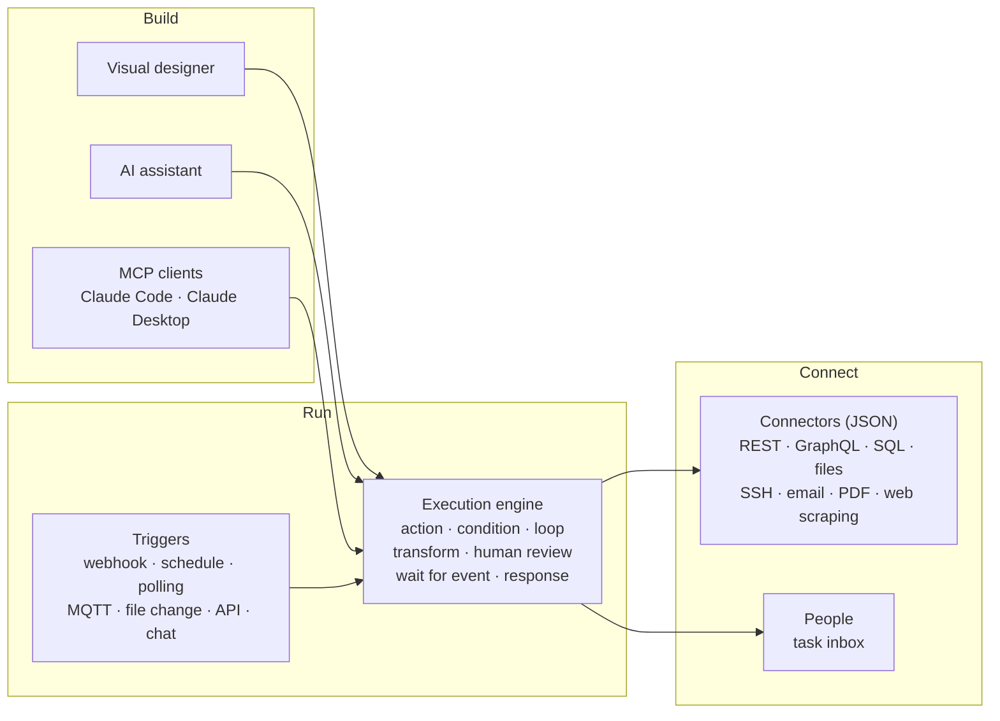

<p align="center">
  
</p>

<h1 align="center">IOFlow</h1>

<p align="center">
  <strong>Open-source workflow automation that you can build by hand or hand to an AI agent.</strong><br/>
  Design flows on a visual canvas, add connectors as JSON files, and let Claude or any MCP client build both for you.
</p>

<p align="center">
  <a href="LICENSE"></a>
  
  
  
  
</p>

<p align="center">
  <a href="#quick-start">Quick start</a> ·
  <a href="docs/FEATURES.md">Feature tour</a> ·
  <a href="#connectors">Connectors</a> ·
  <a href="#build-with-ai-agents">Build with AI agents</a> ·
  <a href="#extend-ioflow">Extend</a> ·
  <a href="docs/CONTRIBUTING.md">Contribute</a>
</p>

---

## What is IOFlow?

IOFlow connects applications and automates the work between them. A **flow** starts from a trigger (a webhook, a schedule, an MQTT message, an API call, a chat message), runs through actions, conditions, loops and Python transforms, and can pause for a person to review before it continues.

It is a self-hosted, multi-tenant platform with a FastAPI backend and a React designer, released under the MIT license.

## Why IOFlow

- **AI agents are first-class builders.** The whole platform is exposed as 90+ [MCP](https://modelcontextprotocol.io) tools. Claude Code, Claude Desktop, or your own agent can explore connectors, design a flow, validate it, and read its execution logs. A Claude Code plugin with ready-made agents is included.
- **A connector is a JSON file.** Describe an API's auth, services and webhook events in JSON and it shows up in the designer with generated forms. No code, no rebuild. 50+ connectors ship in the repo.
- **People are part of the flow.** A Human Review node pauses a run, assigns a task to a user or role, and escalates or auto-decides on timeout. Reviewers work from a task inbox and are notified in the app and by email.
- **Flows become products.** Publish a flow as a REST API with generated documentation, as a reusable connector for other flows, or as a hosted web app with its own landing page and embed code.
- **You can debug it.** Step through a run node by node, inspect and edit variables mid-run, and step through transform code line by line with breakpoints.
- **Python where you need it.** Transform nodes run Python. Describe what you want in plain language and the built-in assistant writes the transform.

## How it works



## Features

| | |
|---|---|
| **Flow designer** | React Flow canvas with schema-driven parameter forms, a variable picker, a visual condition builder, undo/redo, live validation, JSON import and export, and real-time co-editing with live cursors. |
| **Triggers** | Application webhooks, schedules (interval, cron, timezone-aware), API polling with change detection, MQTT, file changes, HTTP API calls (async or synchronous), chat input, and manual runs. |
| **Nodes** | Action, Condition, Loop (`forEach`, `while`, `for`), Transform (Python), Human Review, Wait for Event, and Response for synchronous API flows. |
| **Reliability** | Per-node retries with fixed or exponential backoff and jitter, retry by error class, continue-on-error with fallback output, and error branches. |
| **Connections** | OAuth2 (authorization code with PKCE, client credentials, refresh), API key, basic auth, token exchange, and custom headers. Credentials are encrypted at rest. |
| **Webhook security** | HMAC signature checks (SHA-256, SHA-1, SHA-512) with replay protection, challenge handshakes, and token verification. |
| **Debugging** | Step-by-step execution, variable inspection and editing during a run, and a line-by-line transform debugger with breakpoints. |
| **Publishing** | Per-flow API docs with cURL, Python, JavaScript and PHP samples; flows as reusable connectors; hosted flow apps with a block-based landing page builder and iframe, widget or modal embeds. |
| **Operations** | Execution history with live updates, polling logs, usage dashboards, per-flow third-party cost metering with daily budgets, and prepaid balances with usage limits. |
| **Teams** | Multi-tenant with six roles from instance admin to execution monitor, user invitations, Google sign-in, API keys, and flow visibility scopes (user, tenant, global). |

See the **[feature tour](docs/FEATURES.md)** for details on each area, including what is still in progress.

## Connectors

50+ connectors ship as JSON files in [`backend/seed-applications/`](backend/seed-applications/), with 1,300+ actions and 370+ events between them.

| Category | Connectors |
|---|---|
| **AI** | OpenAI, Anthropic (Claude), Google Gemini, ElevenLabs, AI Agent (Google ADK) |
| **Vector databases** | Pinecone, Weaviate |
| **Messaging** | Slack, Discord, Telegram, Twilio, WhatsApp (Meta Cloud API, MSG91, WATI) |
| **Email** | Gmail, SendGrid, SMTP, IMAP, POP3 |
| **Google Workspace** | Gmail, Calendar, Drive, Sheets, Tasks, Keep |
| **Social** | Facebook, Instagram, LinkedIn, X (Twitter) |
| **E-commerce** | Shopify (REST and Admin GraphQL), Amazon Selling Partner API, Flipkart Seller |
| **Databases** | PostgreSQL, MySQL, Oracle, TimescaleDB, Dremio and other Arrow Flight sources |
| **Files and documents** | Local, FTP, SFTP and SMB file systems, Dropbox, Google Drive, PDF processing, image processing, web scraping |
| **Developer and productivity** | GitHub, Asana, Canva, WordPress |
| **Infrastructure and IoT** | SSH commands, MQTT |
| **Finance (India)** | Zerodha Kite Connect, Vayana (GST, e-invoicing) |

Coverage varies by connector: Shopify Admin (430 actions), Amazon SP-API (390) and Flipkart Seller (91) are the deepest, while several others cover a handful of common operations. Missing something? [Adding a connector](#add-a-connector) takes one JSON file.

## Quick start

With Docker, one command starts PostgreSQL, Redis and IOFlow:

```bash
git clone https://github.com/Proteus-Technologies-Private-Limited/ioflow.ai.git
cd ioflow.ai
docker compose --profile app up -d --build
```

Open **http://localhost:7001** and register. The first account becomes the instance administrator.

<details>
<summary><strong>Run from source instead</strong> (Python 3.11+, Node.js 18+)</summary>

```bash
docker compose up -d postgres redis        # database and cache
./build.sh                                 # build the UI, create ./venv, install dependencies
cp backend/.env.example backend/.env       # defaults match the database above
./start_backend.sh                         # UI and API on http://localhost:7001
```

Signing and encryption keys are generated on first start, and the database tables are created automatically.

</details>

Then install the connectors you want from **Admin → Seed Applications**, and build your first flow from the dashboard or from one of the examples in [`flow-design-src/`](flow-design-src/).

The **[getting started guide](docs/GETTING_STARTED.md)** covers both paths, configuration, frontend hot reload for development, optional dependencies, and troubleshooting. Interactive API documentation is served at http://localhost:7001/docs.

## Build with AI agents

IOFlow exposes its design surface over MCP: tools to explore connectors, create and edit them, design and validate flows, edit individual nodes, and read execution details and logs.

**Claude Code.** Create an API key in IOFlow under Settings → API Keys, then:

```bash
export IOFLOW_API_KEY="your_ioflow_api_key_here"
export IOFLOW_BASE_URL="http://localhost:7001"
claude --plugin-dir ./ioflow-plugin
```

The plugin adds three agents (`flow-designer`, `flow-editor`, `seed-app-designer`) and four skills:

```text
/ioflow:design-flow      When a Shopify order is paid, add a row to Google Sheets and post to Slack
/ioflow:edit-flow        Order sync: retry the Sheets step three times with exponential backoff
/ioflow:create-seed-app  Stripe: customers, invoices, and the invoice.paid webhook
/ioflow:list-apps
```

**Claude Desktop and other MCP clients.** Point the client at the bundled stdio proxy, which needs only the Python standard library:

```json
{
  "mcpServers": {
    "ioflow": {
      "command": "python3",
      "args": ["/path/to/ioflow.ai/backend/mcp_server/bridge_proxy.py"],
      "env": {
        "IOFLOW_API_KEY": "your_ioflow_api_key_here",
        "IOFLOW_BASE_URL": "http://localhost:7001"
      }
    }
  }
}
```

**Inside IOFlow.** The built-in assistant designs flows and connectors from a chat panel, using Google ADK (Gemini) or a local Claude Code installation. Transform generation works with OpenAI, Anthropic, Gemini, Azure OpenAI, DeepSeek, and local models through Ollama or LM Studio.

## Extend IOFlow

### Add a connector

A connector is one JSON file: the application, its services (actions), and its events (triggers).

```json
{
  "key": "acme_crm",
  "application": {
    "app_name": "Acme CRM",
    "app_type": "api",
    "description": "Contacts and deals in Acme CRM",
    "category": "CRM",
    "auth_type": "api_key",
    "auth_config": { "header_name": "Authorization", "header_prefix": "Bearer", "api_key_field": "api_key" },
    "base_url": "https://api.acme.example/v1",
    "version": "1.0.0"
  },
  "events": [],
  "services": [
    {
      "service_name": "Create Contact",
      "service_type": "api_call",
      "description": "Create a contact",
      "endpoint_template": "{{base_url}}/contacts",
      "request_config": {
        "method": "POST",
        "parameter_method": "json_payload",
        "body_template": { "email": "{{email}}", "name": "{{name}}" }
      },
      "parameter_schema": {
        "type": "object",
        "properties": {
          "email": { "type": "string", "format": "email" },
          "name": { "type": "string" }
        },
        "required": ["email"]
      }
    }
  ]
}
```

Drop it in `backend/seed-applications/`, install it from Admin → Seed Applications, and the service appears in the designer with a generated form. See the [connector template](backend/seed-applications/SEED_APPLICATION_TEMPLATE.md) and the [JSON structure reference](backend/docs/seed-application-json-structure.md), or ask the `seed-app-designer` agent to write and test one for you.

### Add a plugin

Node types, service executors, auth types and webhook verifiers register through a decorator-based plugin registry and are discovered at startup:

```python
# backend/plugins/builtin/node_handlers/my_node.py
from plugins.registry import PluginRegistry
from plugins.base import NodeHandlerPlugin


@PluginRegistry.node("my_node")
class MyNodeHandler(NodeHandlerPlugin):
    async def execute(self, node_data, context, engine_ctx):
        return {"result": "hello from my node"}
```

A new node type also needs an entry in the flow validator and the designer palette. The [contributing guide](docs/CONTRIBUTING.md) walks through each plugin type.

## Project status

IOFlow was built and used in-house at Proteus Technologies before being open sourced in November 2026. The core (designer, execution engine, connectors, triggers, human review, MCP tools) is the most exercised part. Some edges are rougher, and we would rather tell you than have you find out:

- **Transform code is trusted code.** Transforms run in the backend process with a module allowlist and a timeout, which is not a security sandbox. Give flow design rights only to people you trust.
- **Single process by default.** Leader election and a shared message queue exist for multi-worker deployments, but the server currently starts one worker.
- **In progress:** the app marketplace, online payment for balance top-ups, the Parallel node, a dark theme, and flow version history.

The [feature tour](docs/FEATURES.md) marks what is stable and what is not.

## Documentation

| | |
|---|---|
| [Getting started](docs/GETTING_STARTED.md) | Install, configure, and run IOFlow |
| [Feature tour](docs/FEATURES.md) | Everything IOFlow does, area by area |
| [Flow design guide](docs/flow-design-guide.md) | Node types, variables, loops, and transforms |
| [Flow structure reference](docs/FLOW_STRUCTURE_GUIDE.md) | The flow JSON format |
| [Connector template](backend/seed-applications/SEED_APPLICATION_TEMPLATE.md) | Write a connector |
| [Node error handling](docs/node-error-handling.md) | Retries, fallbacks, and error branches |
| [Usage and cost](docs/FLOW_USAGE_AND_COST.md) | Metering third-party API spend and setting budgets |
| [Agent pack](docs/AGENT_PACK_AND_TENANT_SEED_APPS.md) | How the design agents are defined and shared |
| [Documentation index](docs/INDEX.md) | Everything else |

## Contributing

Contributions are welcome, and connectors are the easiest place to start: one JSON file, no backend code. Bug reports, setup fixes, documentation, plugins and example flows all help. Read the [contributing guide](docs/CONTRIBUTING.md), then open an [issue](https://github.com/Proteus-Technologies-Private-Limited/ioflow.ai/issues) or a pull request.

If IOFlow is useful to you, a star helps other people find it.

## License

IOFlow is open source software released under the [MIT License](LICENSE).

Copyright (c) 2026 Proteus Technologies Private Limited.
